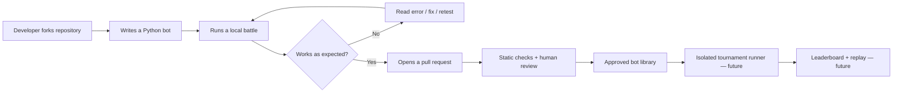

<div align="center">

<a id="top"></a>


<sub>Original artwork · <a href="assets/header.svg">Animated SVG source</a> · The GIF ensures motion on GitHub.</sub>

# FORK ROYALE

**Code your bot. Outsmart your rivals. Build the arena together.**

*An open-source coding arena where your strategy is your character.*

[](docs/ROADMAP.md)
[](https://www.python.org/)
[](LICENSE)
[](LICENSE)
[](docs/START_HERE.fr.md)
[](CONTRIBUTING.md)

[](docs/RULES.md)
[](docs/RULES.md)
[](docs/ARCHITECTURE.md)
[](docs/ROADMAP.md)
[](docs/ROADMAP.md)
[](docs/ROADMAP.md)
[](SECURITY.md)
[](docs/ARCHITECTURE.md)
[](docs/START_HERE.fr.md)
[](docs/START_HERE.fr.md)

<!-- Live GitHub counts use the project owner account. They become available once this repository is published. -->
[](https://github.com/SonicTheLightning/fork-royale/stargazers)
[](https://github.com/SonicTheLightning/fork-royale/forks)
[](https://github.com/SonicTheLightning/fork-royale/issues)
[](https://github.com/SonicTheLightning/fork-royale/graphs/contributors)
[](https://github.com/SonicTheLightning/fork-royale/commits/main)

<br />

[**Start here (FR)**](docs/START_HERE.fr.md) · [**How it works**](#how-it-works) · [**Game rules**](docs/RULES.md) · [**Contribute**](CONTRIBUTING.md) · [**Roadmap**](docs/ROADMAP.md)

</div>

> [!IMPORTANT]
> **Current status: documentation/blueprint, not a playable game.** This starter repository includes the project design and contributor documentation only. The Python engine, CLI, sample bots, automated tests, and tournament infrastructure are **not implemented yet**. Do not interpret planned commands as working features.

## Why this project?

Most programming tutorials make you copy an answer. Fork Royale asks you to **invent a strategy**. Write a bot in Python, challenge another bot on a small turn-based arena, learn from the replay, and improve your code. Beginners can start with an `if` statement; advanced developers can experiment with search algorithms and heuristics.

**Our three rules:** learning beats winning · contributions beat gatekeeping · the game remains free to fork and modify.

### What we're building

| Feature | Version | Status | Description |
|:--|:--:|:--:|:--|
| Deterministic game engine | M1 | ⏳ Planned | Grid, turn order, actions, win conditions |
| Terminal battles | M2 | ⏳ Planned | Simple commands and readable battle logs |
| Example Python bots | M2 | ⏳ Planned | Beginner, aggressive and defensive strategies |
| Tests and lint checks | M2 | ⏳ Planned | Rules, invalid inputs, reproducible battles |
| Community bot submissions | M3 | ⏳ Planned | Pull requests with validation and human review |
| Tournament and leaderboard | M4 | ⏳ Planned | Results calculated from approved, isolated matches |
| Animated replay viewer | M5 | ⏳ Planned | Optional browser visualization, no account required |

## How it works



**Trust boundary:** community-submitted Python files are untrusted code. Reviewing a PR is not permission to execute it in a privileged GitHub Actions runner. See [SECURITY.md](SECURITY.md).

## The arena (draft rules, not running code)

Two bots take turns on a **10 × 10** grid. Each starts with **10 HP**. Each action is exactly one of `move`, `attack`, or `defend`. Moving is one orthogonal cell. Attacking hits a neighboring cell (Manhattan distance = 1) for 2 damage. Defending reduces the next received attack by 1 damage until the bot's next action. The game ends when a bot reaches 0 HP or after 60 rounds; the surviving bot wins, otherwise the bot with the most HP wins, or the match is a draw on equal HP. All randomness must use a recorded seed.

These values are a **proposed contract** and may be revised in a documented rule-version change. Full details and invalid-action handling: [docs/RULES.md](docs/RULES.md).

### Example future bot API

> **Illustrative API only — do not run this code yet.** The engine and import contract do not exist at this stage.

```python
class MyFirstBot:
    name = "hello_world"

    def play(self, observation: dict) -> dict:
        me = observation["self"]
        enemy = observation["enemies"][0]
        distance = abs(me["x"] - enemy["x"]) + abs(me["y"] - enemy["y"])

        if distance == 1:
            return {"action": "attack", "target": enemy["id"]}

        if me["x"] < enemy["x"]:
            return {"action": "move", "direction": "right"}
        if me["x"] > enemy["x"]:
            return {"action": "move", "direction": "left"}
        if me["y"] < enemy["y"]:
            return {"action": "move", "direction": "down"}
        return {"action": "move", "direction": "up"}
```

The observation contains only public match state. The engine will validate actions and avoid leaking opponent implementation details.

## Getting started: step by step

### Step 0 — What you need

- A computer running Windows, macOS or Linux.
- [Git](https://git-scm.com/downloads) to download and version the project.
- [Python](https://www.python.org/downloads/) **3.11 or newer** for the future game engine.
- A terminal (PowerShell, Terminal, bash or equivalent). A GitHub account is only needed to submit changes online.

Verify Git and Python before going further:

```bash
git --version
python --version
```

On systems where `python` does not work, try `python3 --version` (common on macOS/Linux) or `py -3 --version` (Windows Python Launcher). Substitute the working launcher in later Python commands. If the command fails, see the [French troubleshooting guide](docs/TROUBLESHOOTING.fr.md).

### Step 1 — Create or clone the repository

This template is not published to your account automatically. First create a **public repository named `fork-royale`** in the connected `SonicTheLightning` account, then upload these files, preserving their folders. If you publish under another account, replace the owner in README links/badges and clone commands.

```bash
git clone https://github.com/SonicTheLightning/fork-royale.git
cd fork-royale
git status
```

**Expected:** `git status` prints the current branch and its working-tree status. If Git returns `Repository not found`, check that the repository exists, the owner is correct, and your access is authorized.

### Step 2 — Learn the project before coding

1. Read [the beginner's guide in French](docs/START_HERE.fr.md).
2. Read [the exact game rules](docs/RULES.md).
3. Look at the [proposed architecture](docs/ARCHITECTURE.md) and [roadmap](docs/ROADMAP.md).
4. For your first contribution, fix a typo or improve a confusing explanation. No Python execution is necessary for documentation-only changes.

### Step 3 — Set up the future Python environment

When milestone **M1** adds `pyproject.toml` and the `fork_royale` package, create a virtual environment:

```bash
python -m venv .venv
```

Activate it on macOS/Linux:

```bash
source .venv/bin/activate
```

Activate it in Windows PowerShell:

```powershell
.\.venv\Scripts\Activate.ps1
```

If PowerShell blocks activation, **do not change your machine-wide execution policy** just to run this project. You can directly call `.\.venv\Scripts\python.exe` for subsequent commands. Full help: [troubleshooting](docs/TROUBLESHOOTING.fr.md).

### Step 4 — Future commands (not implemented)

The following is the **intended** interface after M2, **not a working demo**:

```bash
python -m pip install -e ".[dev]"
python -m pytest
python -m fork_royale.cli battle --bot bots/my_first_bot.py --vs bots/aggressive.py --seed 42
```

Never run a bot from a stranger on your host. The first executable milestone will support only locally trusted sample bots; isolated execution of third-party bots is a separate security milestone.

## Repository layout

**Included now (documentation starter):**

```text
fork-royale/
├── .github/
│   ├── ISSUE_TEMPLATE/
│   │   ├── bug_report.yml
│   │   └── feature_request.yml
│   └── pull_request_template.md
├── assets/
│   ├── header.svg          # Animated vector source
│   ├── footer.svg          # Animated vector source
│   ├── header.gif          # GitHub-compatible animated banner
│   └── footer.gif          # GitHub-compatible animated footer
├── docs/
│   ├── START_HERE.fr.md    # Absolute beginner walkthrough
│   ├── ARCHITECTURE.md     # Design and trust boundaries
│   ├── GITHUB_SETUP.md     # Publication checklist + 20 topics
│   ├── RULES.md            # Exact proposed rules
│   ├── ROADMAP.md          # Milestones and acceptance criteria
│   └── TROUBLESHOOTING.fr.md
├── tools/
│   └── render_assets.py    # Rebuild the SVG and GIF assets
├── .gitignore
├── README.md
├── CONTRIBUTING.md
├── CODE_OF_CONDUCT.md
├── SECURITY.md
└── LICENSE
```

**Planned code layout (files do not exist yet):**

```text
fork-royale/
├── fork_royale/
│   ├── __init__.py
│   ├── engine.py           # Pure game logic
│   ├── rules.py            # Validation and versioned rules
│   ├── models.py           # Bot observations / action schema
│   ├── cli.py              # Terminal interface
│   ├── replay.py           # Deterministic events / serialization
│   └── tournament.py      # Batch match orchestrator
├── bots/
│   ├── beginner.py
│   ├── aggressive.py
│   └── defensive.py
├── tests/
│   ├── test_rules.py
│   ├── test_engine.py
│   ├── test_replay.py
│   └── test_invalid_actions.py
├── .github/workflows/ci.yml
└── pyproject.toml
```

## Roadmap and definition of done

| Milestone | Implement | Verify before merging |
|:--|:--|:--|
| **M0 · Docs** | Identity, rules, newcomer guide, issue templates | All internal links resolve, docs say what is planned |
| **M1 · Engine** | Grid, turn order, typed actions, deterministic seed | Unit tests for movement, hit, defense, draw, invalid actions |
| **M2 · First battle** | CLI + 3 trusted bots + replay event log | `pytest` passes; identical seed gives identical replay |
| **M3 · Community** | Bot template, contribution review, static checks | Bad import, invalid schema and malicious PRs never gain privileges |
| **M4 · Tournaments** | Isolated runner, time/memory/network limits, leaderboard | Security review + adversarial and timeout tests |
| **M5 · Viewer** | Optional replay interface | Handles invalid replay files without executing code |

Every milestone must include **happy path, failure cases, tests, docs, and a reproducible demonstration**. No badge should say `passing` or `released` before that is true. See [ROADMAP.md](docs/ROADMAP.md).

## How to contribute

You do **not** have to be a great programmer. Start with a spelling correction, a clearer installation step, a new test case, or (later) a bot strategy. Always check [CONTRIBUTING.md](CONTRIBUTING.md) before opening a pull request.

```bash
git switch -c docs/my-first-contribution
# Edit the file and review your changes.
git diff --check
git status
git add README.md
git commit -m "docs: clarify the getting started section"
git push -u origin docs/my-first-contribution
```

These commands are for an **example README-only change**. If you edited another file, replace `README.md` in `git add`. Opening a PR is done through GitHub after pushing. If pushing fails with `permission denied`, make sure you are pushing to **your own fork**, not someone else's repository.

## Errors and support

| Symptom | First check | Next action |
|:--|:--|:--|
| `git: command not found` | `git --version` | Install Git, reopen the terminal |
| `python: command not found` | `python3 --version` or `py -3 --version` | Install Python 3.11+ and verify PATH |
| `Repository not found` | GitHub URL and repo visibility | Create repo / verify repository owner |
| `Permission denied (publickey)` | Git remote and authentication method | Use HTTPS with Git Credential Manager or configure SSH |
| PowerShell denies `Activate.ps1` | `.venv` exists? | Call `.venv\Scripts\python.exe` directly |
| `No module named fork_royale` | Milestone M1 implemented? | Expected before M1; do not install a guessed package |
| A README image is missing | `assets/` committed? | Commit GIFs and SVGs with original relative paths |
| A badge says `repo not found` | Repository owner correct and published? | Correct the owner in README or publish the repository |

Full explanations, commands, and when to open an issue: [TROUBLESHOOTING.fr.md](docs/TROUBLESHOOTING.fr.md).

## Contributing safely

Only code you trust may run locally during early development. Future tournaments must enforce an isolated, resource-limited execution boundary without credentials, write access, or network by default. CI must not check out and execute untrusted PR code inside a privileged `pull_request_target` or `workflow_run` job. See [SECURITY.md](SECURITY.md).

## Publishing this repository

The complete instructions for creating the public GitHub project, configuring the description, **20 searchable topics**, and rebuilding the original artwork are in [docs/GITHUB_SETUP.md](docs/GITHUB_SETUP.md). The starter does not create or change a GitHub repository automatically.

## License and community

Licensed under [MIT](LICENSE) so you can study, modify, fork and redistribute the code under its terms. Please follow our [Code of Conduct](CODE_OF_CONDUCT.md) and report security issues privately as described in [SECURITY.md](SECURITY.md).

**No paywall. No mandatory account to play locally. Every contribution matters.**

<div align="center">


<sub><a href="assets/footer.svg">View animated SVG footer</a></sub>

**Thank you for building this arena with us.**

If this project taught you something or made you smile, **give it a ⭐ on GitHub** and share it with a friend.

[⭐ Star this project](https://github.com/SonicTheLightning/fork-royale) · [Contribute](CONTRIBUTING.md) · [Back to top](#top)

</div>
