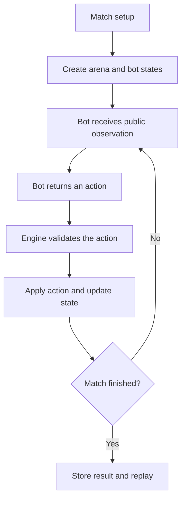

<div align="center">

<a id="top"></a>


# FORK ROYALE

**Code your bot. Outsmart your rivals. Build the arena together.**

*A planned open-source coding battleground where your strategy becomes your character.*

[](https://github.com/SonicTheLightning/fork-royale/tree/rufus-updates)
[](https://github.com/SonicTheLightning/fork-royale/tree/rufus-updates)
[](https://www.python.org/)
[](#the-arena-concept)
[](#the-arena-concept)
[](#project-status)
[](#project-status)
[](#project-status)
[](LICENSE)

[](https://github.com/SonicTheLightning/fork-royale/stargazers)
[](https://github.com/SonicTheLightning/fork-royale/forks)
[](https://github.com/SonicTheLightning/fork-royale/issues)
[](https://github.com/SonicTheLightning/fork-royale/pulls)
[](https://github.com/SonicTheLightning/fork-royale/graphs/contributors)
[](https://github.com/SonicTheLightning/fork-royale/commits/rufus-updates)
[](https://github.com/SonicTheLightning/fork-royale/releases)

<br />

[Overview](#overview) · [Status](#project-status) · [Arena](#the-arena-concept) · [Roadmap](#planned-features) · [Getting started](#getting-started) · [Contributing](#contributing) · [Acknowledgements](#acknowledgements)

</div>


> [!IMPORTANT]
> **Fork Royale is currently a project blueprint, not a playable game.** The `rufus-updates` branch currently contains the README, MIT license and the original header and footer SVG assets. The Python engine, bot API, command-line interface, sample bots, automated tests, tournament runner and replay viewer have not been implemented. The rules and workflow below describe the proposed design only.

## Overview

Fork Royale is planned as a programming game built around autonomous Python bots. Instead of controlling a character directly, each player writes a small program that decides what their bot should do. Bots will compete on a compact, turn-based arena where positioning, timing and strategy matter.

The goal is to make programming more hands-on and approachable. A beginner should be able to start with basic conditions and simple movement rules, while more experienced developers can explore heuristics, pathfinding and decision-making algorithms.

### What the project aims to teach

- **Python fundamentals:** functions, conditions, data structures and clean program design.
- **Algorithmic thinking:** evaluate a board state and choose an action under constraints.
- **Game logic:** turns, state transitions, validation, win conditions and deterministic outcomes.
- **Testing and debugging:** reproduce a match, inspect decisions and test edge cases.
- **Security awareness:** understand why user-submitted bot code must be isolated before execution.
- **Open-source collaboration:** use Git, issues, code review and documented contribution workflows.

These are intended learning outcomes. They are not yet delivered by a playable implementation.

### Project principles

- **Learn by building:** write strategies, observe their results and improve them.
- **Play fair:** deterministic matches and clearly defined rules.
- **Build in the open:** keep the project free to study, fork and contribute to under the MIT License.


## Project status

| Component | Current status |
|:--|:--|
| Project concept and README | Present |
| MIT license | Present |
| Original animated header and footer artwork | Present |
| Neon section divider | Included in this README update |
| Game rules | Draft described in the README only |
| Python game engine | Not implemented |
| Bot interface / API | Not implemented |
| Command-line interface | Not implemented |
| Example bots | Not implemented |
| Automated tests | Not configured |
| CI workflow | Not configured |
| Bot sandbox | Not implemented |
| Tournament and leaderboard | Not implemented |
| Replay viewer | Not implemented |

No installation or gameplay command is available yet. Python **3.11 or newer is the target for the planned engine**, not an installed dependency or a present runtime requirement.

## The arena concept

The current rules proposal describes a **10 × 10 grid** with two competing bots. Each bot starts with **10 HP** and chooses one action per turn:

| Action | Draft behaviour |
|:--|:--|
| `move` | Move one cell in an orthogonal direction. |
| `attack` | Hit an adjacent cell for 2 damage. |
| `defend` | Reduce the next incoming attack by 1 damage until the bot's next action. |

A match is proposed to end when a bot reaches 0 HP or after 60 rounds. If the round limit is reached, the bot with more HP wins. Equal HP results in a draw. Random behaviour, if introduced, must use a recorded seed so a match can be reproduced.

These values are **draft design decisions**, not rules enforced by a working engine. They may change before implementation.

### Planned match flow



*This diagram illustrates the intended flow. None of these runtime steps is implemented yet.*


## Planned features

| Milestone | Planned feature | Goal |
|:--|:--|:--|
| M1 | Deterministic game engine | Grid, turns, action validation and win conditions |
| M2 | First playable battles | CLI, trusted example bots and reproducible battle logs |
| M3 | Community bot format | Documented bot interface and review workflow |
| M4 | Tournaments | Isolated execution, match results and leaderboard |
| M5 | Replay viewer | Optional visual playback of completed matches |

A milestone should only be marked complete when its implementation, tests, documentation and reproducible demonstration are available.

## Getting started

### What you need today

- [Git](https://git-scm.com/) to clone the repository.
- A terminal such as PowerShell, Windows Terminal, Bash or macOS Terminal.
- Python 3.11+ will be needed when the planned engine is implemented. It is not required to read the current project files.

### Clone the development branch

```bash
git clone --branch rufus-updates --single-branch https://github.com/SonicTheLightning/fork-royale.git
cd fork-royale
git status
```

At this stage, you can inspect the README, MIT license and SVG assets. There is no game to launch, no package to install and no test command to run yet.

### When the engine exists

Installation instructions, Python environment setup and test commands will be added alongside the actual package configuration. Commands should not be documented as executable until the corresponding files and workflows exist in the repository.

## Repository structure

The branch currently contains the following files. The `divider.svg` file is supplied in the companion ZIP and must be added to `assets/` when applying this README update.

```text
fork-royale/
├── assets/
│   ├── divider.svg        # New neon section separator
│   ├── footer.svg         # Existing original animated SVG artwork
│   └── header.svg         # Existing original animated arena banner
├── LICENSE                # MIT License
└── README.md              # Project overview and current status
```

The engine, documentation folder, tools, bots, tests and GitHub workflows are future work. They are not part of the current branch structure.

## Security direction

Community-submitted bots must be treated as **untrusted code**. A future tournament runner must not execute arbitrary submissions with access to developer credentials, repository write permissions or unrestricted network access. It will need a clearly defined isolation boundary and resource limits before public bot execution is enabled.

Until that system exists, do not run unknown bot submissions on a machine containing sensitive files or credentials. A code review or pull request approval is not a security sandbox.

## Contributing

The project is at an early blueprint stage and does not yet contain a formal contribution guide, issue templates or automated review workflow. Before implementing a major feature, open an issue to discuss the proposed behaviour and rules with the repository owner.

Useful early contributions include clarifying the game rules, identifying edge cases, discussing the bot interface and reviewing the security model. Runtime contributions should follow once the engine architecture has been agreed.

[](https://github.com/SonicTheLightning/fork-royale/issues)
[](https://github.com/SonicTheLightning/fork-royale/tree/rufus-updates)

## License

Fork Royale is distributed under the [MIT License](LICENSE). You may use, copy, modify, merge, publish, distribute, sublicense and sell copies of the project, subject to the license terms and preservation of the copyright and permission notice.

## Acknowledgements

- **SonicTheLightning:** project owner and maintainer, for creating and maintaining Fork Royale.
- **Original Fork Royale artwork:** the existing `assets/header.svg` and `assets/footer.svg` files are retained in the repository. Their artwork and animation are not replaced by this README update.
- **Shields.io:** [shields.io](https://shields.io/) provides the repository, license and project-status badges.
- **Capsule Render:** [capsule-render](https://github.com/kyechan99/capsule-render) generates the animated SVG footer shown below.
- **GitHub:** [github.com](https://github.com/) hosts the repository and supports project collaboration.

No additional third-party art or game-asset credits are declared in the current tracked files. Any external assets introduced later should be credited here with their original creator, source and license.


<div align="center">


<sub>Original repository footer artwork, kept intact as a local SVG asset.</sub>

**THANK YOU FOR CHECKING OUT FORK ROYALE**

[](https://github.com/SonicTheLightning/fork-royale/stargazers)
[](https://github.com/SonicTheLightning/fork-royale/issues)

[Back to top](#top) · [View repository](https://github.com/SonicTheLightning/fork-royale) · [Browse open issues](https://github.com/SonicTheLightning/fork-royale/issues)

</div>


