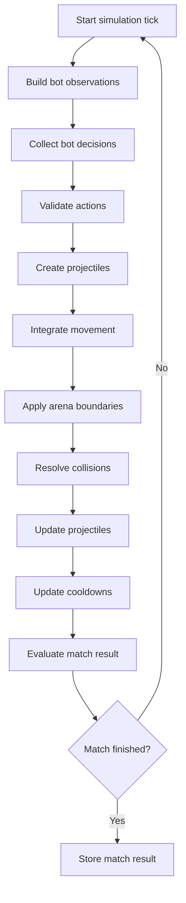
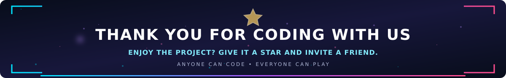

 <div align="center">

<a id="top"></a>



# FORK ROYALE

**WRITE YOUR BOT. MOVE FREELY. OUTSMART THE ARENA.**

A Python bot battleground built around a continuous 2D combat simulation.

<p>
<a href="https://github.com/SonicTheLightning/fork-royale/tree/rufus-updates"></a>


<a href="LICENSE"></a>
</p>

<p>
<a href="https://github.com/SonicTheLightning/fork-royale/stargazers"></a>
<a href="https://github.com/SonicTheLightning/fork-royale/forks"></a>
<a href="https://img.shields.io/github/issues/SonicTheLightning/fork-royale"></a>
<a href="https://github.com/SonicTheLightning/fork-royale/pulls"></a>
<a href="https://github.com/SonicTheLightning/fork-royale/commits/rufus-updates"></a>
</p>

<p>


</p>

<p>


</p>

`$ git switch rufus-updates` | `> continuous movement / autonomous bots / open source`

[OVERVIEW](#overview) · [FEATURES](#features) · [ARCHITECTURE](#architecture) · [FILE MAP](#complete-file-map) · [BOT API](#bot-api) · [INSTALLATION](#getting-started) · [ROADMAP](#roadmap)

</div>


## Overview

Fork Royale is an open source programming game where players develop autonomous Python bots to compete inside a shared 2D arena.

Each bot observes the current world state and returns a structured decision. The simulation engine processes these actions, calculates movement, handles collisions and combat, and determines the outcome of the match.

The central principle is **free and continuous movement**.

Characters are not restricted to a tile grid or four predefined directions. They move through a continuous coordinate system using vectors, velocity and acceleration.

The project combines game development, physics simulation, artificial intelligence, software architecture and competitive programming.

<div align="center">


</div>

```text
$ fork-royale --ticks 600

[engine]       continuous 2D simulation
[physics]      movement / collisions / boundaries
[controller]   Python bot decisions
[combat]       projectiles / damage / cooldowns
[renderer]     ASCII arena
[replay]       JSONL recording

[status]       prototype operational
```

## Features

<div align="center">


</div>

| System | Current state |
|:--|:--|
| Continuous 2D movement | Implemented |
| Vector mathematics | Implemented |
| Acceleration and speed limits | Implemented |
| Arena boundaries | Implemented |
| Circle collision detection | Implemented |
| Obstacle collision handling | Implemented |
| Projectile combat | Implemented |
| Health and match termination | Implemented |
| Python bot protocol | Implemented |
| In-process bot manager | Implemented |
| Local subprocess adapter | Implemented |
| ASCII rendering | Implemented |
| JSONL replay recording | Implemented |
| Replay file reader | Implemented |
| Graphical interface | Planned |
| Production bot sandbox | Planned |
| Multiplayer networking | Planned |
| Tournament infrastructure | Planned |

<text></text>


## Free Movement Arena

The arena uses continuous coordinates instead of a fixed grid.

Characters can move diagonally, change direction, accelerate and slow down. Their positions are calculated using a fixed simulation timestep.

### Movement model

| Property | Description |
|:--|:--|
| `x`, `y` | Continuous world coordinates |
| `velocity_x`, `velocity_y` | Current velocity |
| `acceleration` | Movement acceleration |
| `max_speed` | Maximum movement speed |
| `radius` | Circular collision radius |
| `hp` | Current health |
| `fire_cooldown_remaining` | Remaining firing cooldown |

Example:

```python
from fork_royale.physics.vector import Vec2

position = Vec2(428.35, 176.82)
velocity = Vec2(12.5, -4.2)
```

Positions are not rounded to cells during simulation.

The ASCII renderer uses a simplified visual representation. This does not affect the underlying physics.

### Prototype configuration

<div align="center">


</div>

| Parameter | Default |
|:--|--:|
| Arena width | 1000 units |
| Arena height | 700 units |
| Simulation frequency | 30 ticks/s |
| Maximum entity speed | 260 units/s |
| Acceleration | 720 units/s² |
| Starting health | 100 HP |
| Projectile damage | 10 HP |
| Projectile speed | 520 units/s |
| Match duration | 1800 ticks |

These parameters are configurable through `GameConfig`. They are provisional and require further playtesting.

### Simulation pipeline



All active bots receive observations from the same pre-action world state.

The engine remains authoritative over simulation, physics, collisions, combat and match results.


## Architecture

Fork Royale uses a modular Python package architecture.

The simulation is separated from bot execution, gameplay rules, physics, rendering and replay management.

<div align="center">


</div>

### Complete File Map

The tree below represents the actual contents of the `rufus-updates` branch, including reserved placeholders.

#### Root and assets

```text
fork-royale/
│
├── .gitignore
├── LICENSE
├── README.md
├── README-IMPLEMENTATION-NOTES.md
├── pyproject.toml
│
├── assets/
│   ├── header.svg
│   ├── footer.svg
│   └── fork-royale-divider.svg
```

<sub>`assets/` contains the repository's visual identity: header, footer and reusable section divider.</sub>


#### Documentation

```text
docs/
├── BOT_API.md
├── ENGINE_ARCHITECTURE.md
├── GAME_DESIGN.md
├── ROADMAP.md
└── SECURITY.md
```

| File | Responsibility |
|:--|:--|
| `BOT_API.md` | Bot observation and action protocol |
| `ENGINE_ARCHITECTURE.md` | Internal engine architecture |
| `GAME_DESIGN.md` | Game mechanics and prototype rules |
| `ROADMAP.md` | Development milestones |
| `SECURITY.md` | Bot execution and isolation requirements |

`BOT_API.md` and `ENGINE_ARCHITECTURE.md` are currently empty placeholders.


#### Example bots

```text
examples/
├── __init__.py
│
├── idle_bot/
│   ├── __init__.py
│   ├── bot.py
│   └── main.py
│
└── sample_bot/
    ├── __init__.py
    ├── bot.py
    └── main.py
```

| File | Responsibility |
|:--|:--|
| `examples/__init__.py` | Examples package |
| `idle_bot/__init__.py` | Idle bot package |
| `idle_bot/bot.py` | Idle bot module |
| `idle_bot/main.py` | External idle bot entry point |
| `sample_bot/__init__.py` | Sample bot package |
| `sample_bot/bot.py` | Sample bot module |
| `sample_bot/main.py` | External sample bot entry point |

The examples demonstrate both passive and pursuit-based bot behaviour.


#### Source code

```text
src/
└── fork_royale/
    │
    ├── __init__.py
    ├── __main__.py
    ├── config.py
    │
    ├── bots/
    │   ├── __init__.py
    │   ├── examples.py
    │   ├── manager.py
    │   ├── protocol.py
    │   └── runner.py
    │
    ├── cli/
    │   ├── __init__.py
    │   └── main.py
    │
    ├── core/
    │   ├── __init__.py
    │   ├── clock.py
    │   ├── engine.py
    │   ├── entity.py
    │   ├── events.py
    │   ├── simulation.py
    │   └── world.py
    │
    ├── gameplay/
    │   ├── __init__.py
    │   ├── actions.py
    │   ├── combat.py
    │   └── rules.py
    │
    ├── interface/
    │   ├── cli.py
    │   └── renderer.py
    │
    ├── physics/
    │   ├── __init__.py
    │   ├── boundaries.py
    │   ├── collision.py
    │   ├── geometry.py
    │   ├── movement.py
    │   └── vector.py
    │
    ├── rendering/
    │   ├── __init__.py
    │   ├── assets.py
    │   ├── camera.py
    │   └── renderer.py
    │
    └── replay/
        ├── __init__.py
        ├── player.py
        ├── reader.py
        └── recorder.py
```


### Source Module Map

#### `core/`

<div align="center">

</div>

| File | Responsibility |
|:--|:--|
| `__init__.py` | Core package exports |
| `clock.py` | Fixed timestep accumulator |
| `engine.py` | Main simulation engine |
| `entity.py` | Entities, projectiles and obstacles |
| `events.py` | Event log and game events |
| `simulation.py` | Reserved simulation module, currently empty |
| `world.py` | Authoritative world state |

#### `physics/`

<div align="center">

</div>

| File | Responsibility |
|:--|:--|
| `__init__.py` | Physics package exports |
| `boundaries.py` | Arena boundaries |
| `collision.py` | Entity and obstacle collisions |
| `geometry.py` | Geometric calculations |
| `movement.py` | Velocity and movement integration |
| `vector.py` | Immutable 2D vector operations |

#### `gameplay/`

<div align="center">

</div>

| File | Responsibility |
|:--|:--|
| `__init__.py` | Gameplay package exports |
| `actions.py` | Bot action validation |
| `combat.py` | Projectile creation and damage |
| `rules.py` | Match termination and results |

#### `bots/`

<div align="center">

</div>

| File | Responsibility |
|:--|:--|
| `__init__.py` | Bot package exports |
| `examples.py` | Built-in reference strategies |
| `manager.py` | Bot decision management |
| `protocol.py` | Observation schema and Bot protocol |
| `runner.py` | Local subprocess execution adapter |

#### `cli/`

| File | Responsibility |
|:--|:--|
| `__init__.py` | CLI package |
| `main.py` | Command-line match launcher |

#### `interface/`

| File | Responsibility |
|:--|:--|
| `cli.py` | Reserved interface placeholder |
| `renderer.py` | Reserved interface placeholder |

The current executable CLI is implemented in `cli/main.py`. Rendering is implemented in `rendering/renderer.py`.

#### `rendering/`

<div align="center">

</div>

| File | Responsibility |
|:--|:--|
| `__init__.py` | Rendering package exports |
| `assets.py` | Repository asset location |
| `camera.py` | World-to-screen transformation |
| `renderer.py` | ASCII arena renderer |

#### `replay/`

<div align="center">

</div>

| File | Responsibility |
|:--|:--|
| `__init__.py` | Replay package exports |
| `player.py` | Reserved replay player placeholder |
| `reader.py` | JSONL replay reader |
| `recorder.py` | Match snapshots and event recording |


#### Tests

```text
tests/
│
├── integration/
│   ├── test_cli.py
│   ├── test_collision_and_combat.py
│   ├── test_engine.py
│   └── test_replay.py
│
├── unit/
│   ├── test_bot_protocol.py
│   ├── test_geometry_collision.py
│   ├── test_movement.py
│   └── test_vector.py
│
├── test_bot_protocol.py
├── test_collision.py
├── test_geometry.py
├── test_movement.py
├── test_runner.py
└── test_simulation.py
```

| Test module | Coverage |
|:--|:--|
| `integration/test_cli.py` | Command-line execution |
| `integration/test_collision_and_combat.py` | Projectile damage |
| `integration/test_engine.py` | Simulation and match termination |
| `integration/test_replay.py` | Replay recording and reading |
| `unit/test_bot_protocol.py` | Action validation |
| `unit/test_geometry_collision.py` | Geometric overlap and collision resolution |
| `unit/test_movement.py` | Continuous movement and speed limits |
| `unit/test_vector.py` | Vector mathematics |
| `test_runner.py` | External bot execution |
| Root `test_*.py` placeholders | Reserved for future tests |

The root-level files with empty contents are retained placeholders. The active tests are organized in `unit/` and `integration/`.


### Configuration and project files

| File | Responsibility |
|:--|:--|
| `.gitignore` | Git exclusions |
| `LICENSE` | MIT license |
| `README.md` | Project documentation |
| `README-IMPLEMENTATION-NOTES.md` | Prototype implementation notes |
| `pyproject.toml` | Build configuration, package metadata and pytest settings |

## Bot API

Bots interact with the simulation through an observation and action protocol.

The current protocol supports trusted in-process Python bots and local subprocess bots using JSON over standard input and output.

### Observation

A bot receives information about its own entity, opponents and the arena.

```json
{
  "bot_id": "player_1",
  "tick": 120,
  "dt": 0.033333,
  "arena": {
    "width": 1000.0,
    "height": 700.0
  },
  "self": {
    "id": "player_1",
    "position": [250.0, 350.0],
    "velocity": [12.0, 0.0],
    "radius": 18.0,
    "hp": 100,
    "max_hp": 100,
    "alive": true
  },
  "opponents": [],
  "obstacles": []
}
```

### Bot decision

A bot returns a structured action.

```json
{
  "move": [1.0, 0.0],
  "aim": [0.0, 1.0],
  "fire": true
}
```

| Field | Description |
|:--|:--|
| `move` | Movement direction |
| `aim` | Independent aiming direction |
| `fire` | Projectile firing request |

Movement and aiming vectors are limited to a maximum length of 1.

This allows a bot to move in one direction while aiming in another.

### Included bots

**IdleBot**

Remains stationary and provides a simple way to verify simulation behaviour.

**SampleBot**

Implements a basic pursuit strategy. It identifies the nearest opponent, moves towards it and fires when the target is within its configured range.

These bots are educational examples, not competitive strategies.


## Physics and Combat

Physics and combat are handled by separate modules.

### Physics

The physics system includes:

- Continuous 2D vector calculations.
- Velocity integration.
- Acceleration and exponential drag.
- Maximum speed constraints.
- Arena boundary constraints.
- Circular collision detection.
- Entity collision resolution.
- Static circular obstacles.

### Combat

The initial combat implementation uses projectiles.

Each projectile contains an owner, position, velocity, collision radius, damage value, maximum range and remaining lifetime.

Firing is controlled by a cooldown system.

All combat parameters remain configurable and subject to balancing.

## Replay System

Matches can be recorded using JSON Lines.

Each replay contains a format header followed by world snapshots and associated game events.

The current reader validates the format and reads individual frames.

Full match playback and timeline visualization are planned for future development.


## Security Model

Community bots must be treated as untrusted programs.

The local subprocess adapter currently provides:

- Process execution without a shell.
- Execution timeouts.
- JSON input and output.
- Basic response validation.
- Error reporting.

**This is not a security sandbox.**

It does not provide operating system isolation, filesystem restrictions, network restrictions or CPU and memory quotas.

Only execute trusted bots on a development machine.

Before accepting arbitrary community submissions, a production environment must implement proper process or container isolation.

See [docs/SECURITY.md](docs/SECURITY.md).

## Getting Started

### Requirements

- Python 3.11 or newer.
- pip.
- Git.

### Clone the repository

```bash
git clone --branch rufus-updates --single-branch https://github.com/SonicTheLightning/fork-royale.git

cd fork-royale
```

### Create a virtual environment

**Windows**

```powershell
python -m venv .venv
.venv\Scripts\Activate.ps1
```

**Linux**

```bash
python3 -m venv .venv
source .venv/bin/activate
```

### Install

```bash
python -m pip install --upgrade pip
pip install -e ".[dev]"
```

### Run a match

```bash
fork-royale
```

Or:

```bash
python -m fork_royale
```

### Useful commands

```bash
# Run a match for 600 ticks
fork-royale --ticks 600

# Run without ASCII rendering
fork-royale --ticks 600 --no-render

# Change arena dimensions
fork-royale --width 1200 --height 800

# Record a match
fork-royale --ticks 600 --replay replays/match.jsonl
```

### Run tests

```bash
pytest
```

The project uses pytest with separate unit and integration test directories.


## Roadmap

Fork Royale is under active development.

| Stage | Goal | Status |
|:--|:--|:--|
| 01 | Establish project architecture | Done |
| 02 | Implement continuous movement | Implemented |
| 03 | Implement physics and collisions | Initial implementation |
| 04 | Implement projectile combat | Initial implementation |
| 05 | Implement bot protocol | Initial implementation |
| 06 | Add CLI and ASCII renderer | Implemented |
| 07 | Add replay recording and reading | Initial implementation |
| 08 | Expand testing and documentation | In progress |
| 09 | Improve collision reliability and replay completeness | Planned |
| 10 | Develop graphical rendering | Planned |
| 11 | Implement secure bot execution | Planned |
| 12 | Build tournament infrastructure | Planned |

Milestones will only be considered complete when the implementation has been tested and the associated documentation is available.

## Contributing

Fork Royale is being developed collaboratively.

The `rufus-updates` branch focuses on the continuous movement architecture and the first playable simulation foundations.

Useful contributions include:

- Improving physics and collision handling.
- Developing bot strategies.
- Reviewing the observation and action protocol.
- Improving test coverage.
- Designing gameplay mechanics.
- Developing graphical rendering.
- Reviewing execution security.

For major gameplay changes, discuss the proposed behaviour before implementation to keep the engine and bot protocol consistent.

<div align="center">

<p>
<a href="https://github.com/SonicTheLightning/fork-royale/issues"></a>
<a href="https://github.com/SonicTheLightning/fork-royale/tree/rufus-updates"></a>
<a href="https://github.com/SonicTheLightning/fork-royale"></a>
</p>

</div>

## License

Fork Royale is distributed under the [MIT License](LICENSE).

See the license file for the complete terms.

## Acknowledgements

- **SonicTheLightning:** Project owner and maintainer.
- **RufusTheDwarf:** Contributor to the `rufus-updates` branch and continuous movement architecture.
- **Shields.io:** Repository status badges.


<div align="center">



**BUILT IN THE OPEN. DRIVEN BY CODE. POWERED BY STRATEGY.**

<p>


</p>

<a href="https://github.com/SonicTheLightning/fork-royale"></a>
<a href="https://github.com/SonicTheLightning/fork-royale/issues"></a>

<br />

[Back to top](#top)

<sub>Fork Royale · Open source programming game · 2026</sub>

</div>
