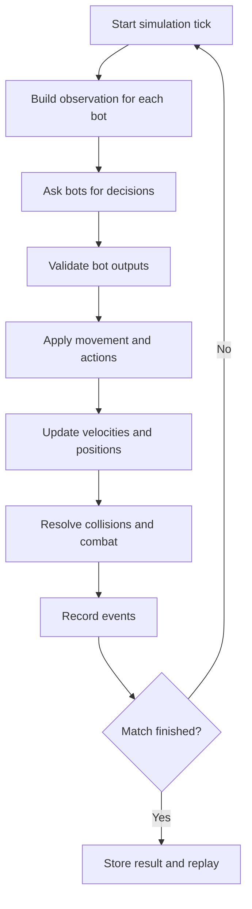

<div align="center">

<a id="top"></a>


# FORK ROYALE

**Write your bot. Move freely. Outsmart the arena.**

A Python bot battleground built around a free movement 2D arena.

<p>
  <a href="https://github.com/SonicTheLightning/fork-royale/tree/rufus-updates"></a>
  <a href="https://github.com/SonicTheLightning/fork-royale/tree/rufus-updates"></a>
  <a href="https://www.python.org/"></a>
  <a href="LICENSE"></a>
  <a href="https://github.com/SonicTheLightning/fork-royale/commits/rufus-updates"></a>
</p>

<p>
  <a href="https://github.com/SonicTheLightning/fork-royale/stargazers"></a>
  <a href="https://github.com/SonicTheLightning/fork-royale/forks"></a>
  <a href="https://github.com/SonicTheLightning/fork-royale/issues"></a>
  <a href="https://github.com/SonicTheLightning/fork-royale/pulls"></a>
</p>

`$ git switch rufus-updates`  |  `> free movement / 2D arena / Python bots`

[Overview](#overview) · [Branch scope](#rufus-updates) · [Movement](#free-movement-arena) · [Architecture](#planned-architecture) · [Roadmap](#roadmap) · [Setup](#getting-started)

</div>


## Overview

Fork Royale is an open source programming game concept. Players create Python bots that make decisions inside a shared 2D battle arena. The bots are the players' interface with the game: they observe the world, choose actions and compete through their own strategies.

The project is intended to make programming practical. A player should be able to start with simple movement logic, then improve their bot with geometry, prediction, pathfinding, decision making and testing.

```text
$ fork-royale --mode arena
[core]       continuous 2D world
[controller] Python bot interface
[simulation] fixed timestep planned
[status]     design in progress
```

## Rufus Updates

The `rufus-updates` branch is where the arena concept and technical foundations are being revised.

Its main design change is the move away from a tile grid. Characters must move freely through the arena instead of stepping from cell to cell.

This branch focuses on:

- Replacing grid based movement with continuous 2D coordinates.
- Defining how bots observe the arena and submit decisions.
- Separating the simulation engine from the visual interface.
- Planning movement, collision and combat as independent systems.
- Establishing a reproducible simulation that can be tested and replayed.
- Documenting the architecture before implementation begins.

The branch currently contains project documentation, the MIT license and the original visual assets. The game engine and bot runtime are not implemented yet. The sections below describe the intended design, not completed gameplay features.

## Free Movement Arena

The arena is a continuous 2D space. There is no 10 × 10 board and no movement limited to four directions.

Characters will be able to:

- Move in any direction, including diagonally.
- Change direction without snapping to a tile.
- Accelerate and slow down according to movement parameters.
- Navigate around obstacles and other characters.
- Aim and use abilities independently from their movement direction, if the final combat design supports it.

Positions and velocities will use floating point values. A character could, for example, be located at `(428.35, 176.82)` rather than at a cell such as `(4, 7)`.

### Movement model

The proposed model uses a fixed simulation timestep. Each bot provides an intention or control vector. The engine validates that input, applies movement limits, updates the character's velocity and position, then resolves collisions.

| Property | Purpose |
|:--|:--|
| `x`, `y` | Continuous world position |
| `velocity_x`, `velocity_y` | Current movement velocity |
| `acceleration` | How quickly velocity can change |
| `max_speed` | Maximum movement speed |
| `radius` | Character collision radius |
| `hp` | Health value, pending final game rules |

The exact movement speed, acceleration, arena dimensions and collision response still need to be defined and tested.

### Simulation loop



All bots should act from a consistent view of the same simulation state. The engine, rather than the bot, remains responsible for physics, collisions, rules and the final state of the match.


## Planned Architecture

The codebase will be split into small modules with clear responsibilities. The simulation must be usable without a graphical window. This allows automated tests, headless tournaments and replay generation to use the same game rules as the visual client.

### Proposed project structure

The following tree is the target structure. These files and folders are not present in the branch yet.

```text
fork-royale/
├── assets/
│   ├── header.svg
│   ├── footer.svg
│   └── fork-royale-divider.svg
│
├── docs/
│   ├── GAME_DESIGN.md
│   ├── ENGINE_ARCHITECTURE.md
│   ├── BOT_API.md
│   ├── SECURITY.md
│   └── ROADMAP.md
│
├── src/
│   └── fork_royale/
│       ├── __init__.py
│       ├── config.py
│       │
│       ├── core/
│       │   ├── simulation.py
│       │   ├── world.py
│       │   ├── entity.py
│       │   ├── clock.py
│       │   └── events.py
│       │
│       ├── physics/
│       │   ├── movement.py
│       │   ├── geometry.py
│       │   └── collision.py
│       │
│       ├── bots/
│       │   ├── protocol.py
│       │   ├── manager.py
│       │   └── runner.py
│       │
│       ├── gameplay/
│       │   ├── actions.py
│       │   ├── combat.py
│       │   └── rules.py
│       │
│       ├── replay/
│       │   ├── recorder.py
│       │   └── player.py
│       │
│       └── interface/
│           ├── cli.py
│           └── renderer.py
│
├── examples/
│   ├── idle_bot/
│   └── sample_bot/
│
├── tests/
│   ├── test_movement.py
│   ├── test_geometry.py
│   ├── test_collision.py
│   ├── test_simulation.py
│   └── test_bot_protocol.py
│
├── pyproject.toml
├── README.md
└── LICENSE
```

### Module responsibilities

| Module | Responsibility |
|:--|:--|
| `core/` | Own the world state, simulation clock, entities and event lifecycle. |
| `physics/` | Calculate movement, geometry, boundaries and collisions. |
| `bots/` | Define the bot protocol and manage bot decisions and execution. |
| `gameplay/` | Validate actions and implement combat and match rules. |
| `replay/` | Record simulation events and reproduce completed matches. |
| `interface/` | Provide command line tools and an optional graphical renderer. |
| `docs/` | Describe game rules, bot integration, architecture, security and milestones. |
| `tests/` | Verify movement, collision, simulation and bot behaviour. |

### Engine and renderer stay separate

The game logic must not depend on the renderer. The engine will update the world and emit state or events. A renderer can display that state without changing the simulation rules.

This separation will make it possible to run matches in a terminal, run automated tournaments without a window and later add a graphical client without rewriting the physics engine.

## Bot Interface

A bot should not directly modify the world. It receives an observation and returns a structured decision. The engine validates the decision and applies it.

The initial protocol is planned around a simple request and response format such as JSON. The exact schema will be defined in `docs/BOT_API.md` before the first public bot examples are released.

A future observation may contain:

- The bot's own position, velocity and status.
- Visible opponents and their positions.
- Nearby obstacles and arena boundaries.
- Available actions, cooldowns and other public state.
- The current simulation tick.

A future decision may contain:

- A movement direction or control vector.
- An optional action or ability request.
- An optional target or aim direction.

The engine will enforce movement limits, action rules and resource limits. A bot must never be trusted to provide valid physics values or to edit another entity's state.

## Physics and Combat

Physics and combat will be implemented as separate systems.

**Physics** will handle continuous positions, velocity, acceleration, arena boundaries and collision detection. Character collisions will initially use simple shapes such as circles or capsules unless testing shows that another model is more appropriate.

**Combat** will handle attacks, projectiles, impact areas, cooldowns, damage and status effects. The combat model is still open for design. No weapon list, damage values or abilities are considered final.

## Project Status

| Component | Status |
|:--|:--|
| Project concept | Documented |
| Free movement direction | Chosen, not implemented |
| Proposed architecture | Documented in this branch |
| Header, footer and divider artwork | Present |
| Python package | Not started |
| Continuous movement engine | Not implemented |
| Collision system | Not implemented |
| Combat system | Not implemented |
| Bot protocol and runner | Not implemented |
| Graphical renderer | Not implemented |
| Replay system | Not implemented |
| Automated tests | Not configured |
| Bot sandbox | Not implemented |

### Decisions still open

The following values must be designed and tested before they become game rules:

- Arena width, height and obstacle layout.
- Movement speed, acceleration and turning behaviour.
- Character size and collision response.
- Health, damage, weapons and abilities.
- Match duration and victory conditions.
- Bot decision frequency and execution time limits.
- Whether the first playable version includes local multiplayer or only bot versus bot matches.

The old 10 × 10 grid proposal and four direction movement are no longer part of the design.


## Security Model

Community bots are untrusted programs. The future bot runner must isolate each bot from the host system and from other players.

Before public bot execution is enabled, the project must define:

- Process or container isolation.
- CPU, memory and execution time limits.
- Restricted filesystem access.
- Network access policy.
- Input and output validation.
- Behaviour when a bot crashes, times out or returns invalid data.

A code review or a successful pull request does not make an executable bot safe. The sandbox is a requirement for running community submissions, not an optional improvement.

## Getting Started

The branch currently contains documentation, the MIT license and visual assets. It does not contain an executable game or installable Python package yet.

Clone the development branch:

```bash
git clone --branch rufus-updates --single-branch https://github.com/SonicTheLightning/fork-royale.git
cd fork-royale
git status
```

You can inspect the project files and contribute to the design. There is currently no `pip install` command, game launch command or test command to run.

Python 3.11 or newer is the planned development target. The exact dependency list will be added to `pyproject.toml` when the first implementation is ready.

## Roadmap

| Stage | Goal | Planned output |
|:--|:--|:--|
| 01 | Confirm game rules | Arena dimensions, movement, combat and victory conditions |
| 02 | Build the simulation core | World state, fixed timestep and deterministic updates |
| 03 | Implement free movement | Vectors, acceleration, speed limits and boundaries |
| 04 | Add collision and combat | Hit detection, projectiles and damage rules |
| 05 | Define the bot protocol | Observation schema, decision schema and example bots |
| 06 | Add a playable interface | CLI first, graphical renderer as a separate module |
| 07 | Test and secure execution | Automated tests, replay logs and bot isolation |
| 08 | Prepare tournaments | Match runner, results and leaderboard |

Milestones will only be marked complete when the code, tests and documentation are present.

## Contributing

Fork Royale is being developed collaboratively. The `rufus-updates` branch is used to prepare the free movement design and its technical foundations.

Before implementing a major gameplay feature, discuss its expected behaviour with the other contributor. This keeps the rules, bot interface and engine architecture consistent.

Useful contributions at this stage include:

- Reviewing the free movement model.
- Identifying collision and physics edge cases.
- Proposing a bot observation and decision format.
- Reviewing the security model for untrusted bots.
- Improving the project documentation.

[](https://github.com/SonicTheLightning/fork-royale/issues)
[](https://github.com/SonicTheLightning/fork-royale/tree/rufus-updates)

## License

Fork Royale is distributed under the [MIT License](LICENSE). See the license file for the full terms.

## Acknowledgements

- **SonicTheLightning:** project owner and maintainer.
- **RufusTheDwarf:** contributor to the `rufus-updates` branch and free movement architecture proposal.
- **Original Fork Royale artwork:** the existing header and footer SVG assets are kept in this branch.
- **Shields.io:** repository badges from [shields.io](https://shields.io/).

<div align="center">


<sub>Fork Royale is built in the open. Read the code, test ideas and help shape the arena.</sub>

<br />

<a href="https://github.com/SonicTheLightning/fork-royale"></a>
<a href="https://github.com/SonicTheLightning/fork-royale/issues"></a>

[Back to top](#top)

</div>
